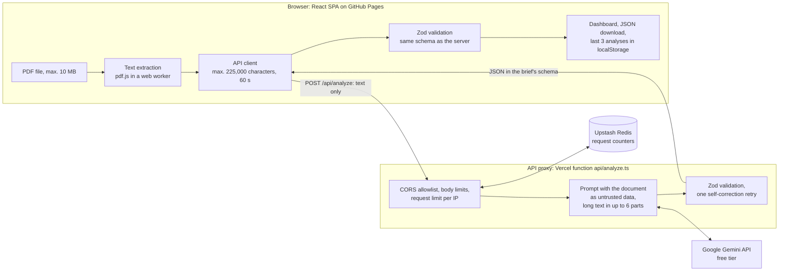

# PDF Insight

Upload a PDF and get a summary with structured data. The text is extracted in the browser;
only the text goes to an API proxy that calls the LLM (Gemini), so the key never reaches
the browser.

Demo: https://devtomaszstoklosa.github.io/PDF-Insight/


## Documentation

The developer reference is in [`docs/`](docs/README.md): architecture, API, server, frontend,
configuration, development and operations.

## Architecture



1. The browser checks the file (PDF, max. 10 MB) and extracts its text layer with pdf.js. The
   file never leaves the device; only the text, the file name and the page count are sent.
2. The Vercel function checks the origin, the body size and the request limit, then asks
   Gemini for a JSON object constrained by a response schema. Text longer than 37,500
   characters is analyzed in up to 6 parts, as described under Key decisions.
3. The server validates the reply with Zod. An invalid reply gets exactly one correction
   request that quotes the validation error; a second invalid reply ends with 502
   `LLM_INVALID_OUTPUT`. Errors reach the user as Polish messages with a stable code.
4. The browser validates the response again with the same schema before it shows anything,
   and keeps the last 3 analyses in `localStorage`, re-validated whenever they are read.

## Key decisions

- **Gemini free tier, `gemini-3.1-flash-lite` by default.** The demo costs nothing and the key
  belongs to a Google Cloud project without billing, so requests above the quota are rejected,
  not charged. On the free tier, `gemini-3.8-flash` took 20–35 s for a one-page invoice and
  sometimes answered 503; the lite model answers with valid output in about 2–10 s
  (#31, #51). The provider sits behind the `LlmClient` interface, so another one needs only a
  new adapter.
- **Text extraction in the browser.** The PDF never reaches a server, uploads stay small, and
  scanned files are rejected before any API call. pdf.js loads only when the first file
  arrives, and its Adobe CMaps are served with the app, so CID-keyed fonts (common in CJK
  documents) also yield text. The app loads the legacy build of pdf.js: the modern build
  calls the newest JavaScript methods without polyfills and fails on iOS, where every browser
  uses WebKit (#56).
- **One data contract.** `src/types/schema.ts` defines the result once with Zod. The server
  derives the JSON schema for the model from it, and both the server and the browser validate
  with it. It follows the layout and key order of the schema in the brief, uses strict objects
  (unknown keys fail), and checks ISO 639-1 languages, ISO 4217 currencies, ISO 8601 dates,
  3–5 summary sentences and 3–7 key points.
- **Analysis in the document's language.** The summary, key points, contexts and keywords are
  written in the document's main language (`document.language`); keys stay in English.
- **One self-correction retry.** Enough to fix a typical schema slip, while capping each
  model call at two replies to validate.
- **One retry after a transient failure (#44, #51).** When Gemini answers 500 or 503, which
  its documentation says to retry, or when the first attempt of a request uses up its 15 s,
  the server waits 1 s plus up to 1 s of jitter and sends the same request once more, with
  25 s, but only if at least 15 s are left before the deadline; otherwise the user gets the
  error at once. On the free tier, 20 of 21 measured replies took 2.2–8.8 s and one 15.6 s,
  while 2 of 9 analyses on the demo stalled past 25 s; a stalled request now ends with a
  result after about 20–28 s instead of an error. A first attempt cut short by the deadline
  is not retried. The SDK's own retries stay off, because they give every attempt the full
  timeout. With the correction retry, one model call takes at most 4 requests, and only when
  errors occur. Every such failure is logged as a warning with what the retry did (#46), so
  its frequency and the minimum time left for a retry can be checked in the logs.
- **Long documents in parts (#24).** Text up to 37,500 characters (about 10–12 dense pages)
  takes one call. Longer text, up to 225,000 characters, is split into at most 6 parts of
  similar length, cut at page, line or word boundaries. At most 3 parts are analyzed at once:
  on the free tier, 3 parallel part-sized requests succeeded, while 6 got 503 for 5 of them.
  The code merges the metadata and the lists: the title comes from the first part,
  repeated names are dropped, and amounts and dates are dropped only when their context
  repeats too. One more call then writes the summary and key points of the whole document from
  the analyses of the parts. Each call has its own correction retry, and the result is
  validated against the same schema.
- **A fixed time budget.** The first attempt of a Gemini request is limited to 15 s and its
  retry to 25 s, and every request must end within 50 s of the start of the analysis: a later
  request gets only the time left, and none starts after that. The server therefore answers
  before the browser's 60 s limit and the function's 60 s `maxDuration`, and a stalled first
  attempt, the wait and a full retry always fit. A timeout ends as 504 `LLM_TIMEOUT` with its
  own message.
- **A post-deploy check.** After each deploy from `main`, the Pages workflow sends a CORS
  preflight to the API and waits until it answers 204 and reports the deployed commit, or a
  newer one that contains it, so a crashing, misconfigured or outdated API fails the run.

## Security

- **The API key stays on the server.** Only the Vercel function reads `LLM_API_KEY`; `VITE_*`
  variables are public and hold no secrets.
- **CORS with an exact allowlist** of origins from `ALLOWED_ORIGIN`; look-alike origins and
  wildcards are rejected. CORS limits which websites can read responses; it is not
  authentication.
- **Limits:** the file (10 MB, checked in the browser), the text (225,000 characters, at most
  6 parts and 3 model calls at once), the request body (JSON only, 1.5 MB, counted while it is
  read) and the file name (255 characters), plus the request limit per IP described below.
- **Untrusted input:** the document text is wrapped in delimiters that the text cannot close,
  and the prompt tells the model to treat instructions inside the document as content. The
  analyses of the parts of a long document are passed on to the final call the same way.
- **No document content in logs:** the function logs error codes and upstream status codes
  only; provider error messages are dropped because they may quote the request. A transient
  failure is logged as a warning, `LLM_TRANSIENT_ERROR` with its `kind` (`server_error` with
  the upstream status, or `timeout`) and `retry` set to `succeeded`, `failed` or `skipped`
  (too little time left for a retry).
- **No storage at the provider:** Gemini requests use `store: false`. The UI asks users not to
  upload confidential documents, as the free-tier terms require.
- **Hardening headers:** `Cache-Control: no-store` and `X-Content-Type-Options: nosniff` on
  every API response.

## Known limitations

- **Long documents:** text above 225,000 characters is rejected. A long document uses up to
  7 model calls (6 parts and the overview), plus any retries, while the request limit per IP
  counts it as one analysis, so two long documents in a minute can reach the free-tier quota.
  The longest documents take about 30 s, and a correction retry late in the analysis can end
  it with 504 at 50 s. Two long documents analyzed at the same time can exceed the 3 parallel
  requests the free tier accepts, and end with 503 when the retry fails too. The overview is
  written from the analyses of the parts, not from the full text, and the same amount
  described differently in two parts is listed twice.
- **Scans:** there is no OCR. A PDF without a text layer ends with a message asking for one.
- **Free-tier quota and load:** when the quota is used up, the API answers 429
  `LLM_QUOTA_EXCEEDED`. Under load, Gemini sometimes answers 503 or stalls. The server retries
  once by itself; when the retry fails too, or too little time is left, the user sees 503
  `LLM_UNAVAILABLE` or 504 `LLM_TIMEOUT`, and trying again later usually works.
- **Safety blocks:** Gemini's Interactions API gives no explicit safety signal, so a blocked
  reply ends as 503 `LLM_UNAVAILABLE`, not as a dedicated error.
- **Request limit per IP:** users behind one shared address share it.
- **Sentence counting is heuristic:** it uses `Intl.Segmenter`, which can misjudge rare
  abbreviations; a wrong count triggers the correction retry.
- **History stays in one browser:** the last 3 analyses live in `localStorage` and disappear
  with the browser data.
- **AI output can be wrong:** the UI says so; check important values against the document.

## Local development

Requirements: Node.js 22 and npm.

```bash
npm ci
cp .env.example .env.local
npm run dev
```

`npm run dev` serves only the frontend. To run the whole flow, upload → analysis → result,
start the API proxy locally as well:

1. In `.env.local` set:
   - `LLM_API_KEY`: a Gemini API key from Google AI Studio,
   - `ALLOWED_ORIGIN=http://localhost:5173`,
   - `VITE_API_URL=http://localhost:3000`,
   - `UPSTASH_REDIS_REST_URL` and `UPSTASH_REDIS_REST_TOKEN`: an Upstash Redis database for
     the request limit (see below).
2. In one terminal run `npm run dev:api`. It serves the real `api/analyze.ts` at
   `http://localhost:3000/api/analyze`, on loopback only.
3. In another terminal run `npm run dev` and open http://localhost:5173.

If port 5173 is taken, Vite picks the next free one. Add that origin to `ALLOWED_ORIGIN`
(comma-separated), or the API rejects the request.

Checks: `npm run typecheck`, `npm run lint`, `npm test`, `npm run format:check`.

## Deployment

### Frontend: GitHub Pages

[`.github/workflows/deploy-pages.yml`](.github/workflows/deploy-pages.yml) runs the checks
and the build on every pull request, and deploys `dist` to GitHub Pages on every push to
`main`. The build uses `VITE_BASE_PATH=/PDF-Insight/`, so the assets, the pdf.js worker and
its CMaps load under `/PDF-Insight/`. The app has a single view and no client-side router, so
GitHub Pages needs neither a `HashRouter` nor a `404.html` fallback.

One-time setup in the repository settings:

- Settings → Pages → Build and deployment → Source: **GitHub Actions**.
- Settings → Secrets and variables → Actions → **Variables**: `VITE_API_URL` with the base
  URL of the deployed API, without `/api/analyze`. It ends up in the public bundle, so it is
  a variable, not a secret. Deploys fail while it is missing.

### API proxy: Vercel

`api/analyze.ts` is a Vercel function. Every other path on the Vercel domain redirects to the
GitHub Pages demo (`vercel.json`). Set these environment variables in the Vercel project:

- `LLM_API_KEY` (secret): use a Google Cloud project without billing, so requests above the
  free tier are rejected instead of charged.
- `LLM_MODEL` (optional): defaults to `gemini-3.1-flash-lite`.
- `ALLOWED_ORIGIN`: must include `https://devtomaszstoklosa.github.io`. An origin has no
  path, so it does not include `/PDF-Insight/`.
- `UPSTASH_REDIS_REST_URL` and `UPSTASH_REDIS_REST_TOKEN` (secret): the REST endpoint and
  token of an Upstash Redis database (the free plan is enough). Both are required; without
  them the API answers `SERVER_MISCONFIGURED`.

Keep "Automatically expose System Environment Variables" on (the default): every API
response carries the deployed commit in `X-App-Version`, read from `VERCEL_GIT_COMMIT_SHA`.
After each deploy, the Pages workflow waits until the API reports the commit it deployed, or
a newer one that contains it (a later merge can reach Vercel first), so a failed or
unpromoted Vercel deployment fails the run.

CORS limits which websites can read the responses; it does not authenticate callers.

#### Request limit

Each client may request 5 analyses per minute and 30 per day; further requests get HTTP 429
`RATE_LIMITED` with a `Retry-After` header. Clients are identified by IP address, which the
API hashes before storing it in Redis. Users behind one shared address share the limit. If
Redis is unreachable or slower than 1 s, the request is allowed and
`RATE_LIMIT_UNAVAILABLE` is logged, so a Redis outage does not take the demo down.
