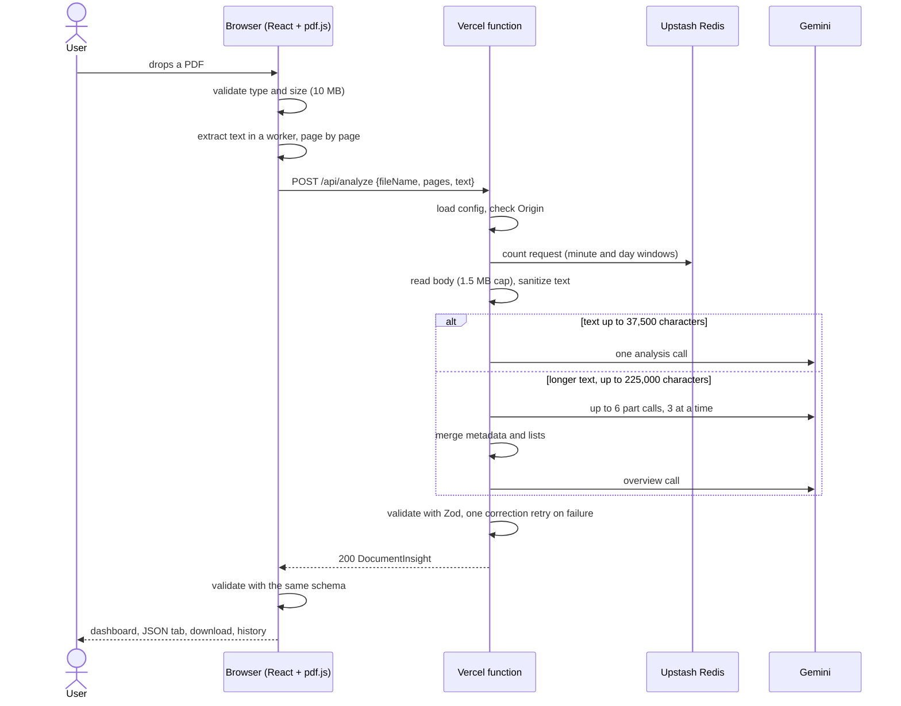

# Architecture

## Parts

| Part             | Technology                                  | Hosted on           | Role                                                  |
| ---------------- | ------------------------------------------- | ------------------- | ----------------------------------------------------- |
| Frontend         | React 18, Vite, TypeScript, pdf.js (legacy) | GitHub Pages        | file check, text extraction, UI, history              |
| API proxy        | Vercel Node.js function (`api/analyze.ts`)  | Vercel              | origin and limit checks, prompting, validation        |
| LLM              | Google Gemini via `@google/genai`           | Google (free tier)  | produces the analysis as JSON                         |
| Request counters | Upstash Redis via `@upstash/ratelimit`      | Upstash (free plan) | per-client request limit                              |
| Shared contract  | Zod 4 schema in `src/types/schema.ts`       | bundled in both     | one definition of the result, validated on both sides |

There is no database and no user account. The only persistent state is the last three
analyses in the visitor's `localStorage` and the request counters in Redis.

## Request flow

The file never leaves the device. The server receives text, the file name and the page count.

## Trust boundaries

1. **Browser to API.** The API trusts nothing from the browser: the origin is checked against
   an allowlist, the body is size-limited while it is read, the JSON is validated with a
   strict schema, control characters are stripped, and a text that starts with `%PDF-` is
   rejected. CORS is not authentication; any non-browser client can send an allowed
   `Origin`, which is why the per-IP request limit exists.
2. **Document to model.** Document text is untrusted data. It is wrapped in `<document>` tags,
   the delimiters are escaped inside it, and the system instruction tells the model to treat
   instructions in the document as content. The analyses of parts are passed to the overview
   call the same way.
3. **Model to API.** Model output is untrusted. It must parse as JSON and pass the Zod schema;
   `fileName` and `pages` are taken from the request, never from the model.
4. **API to browser.** The browser validates the response again before rendering. All values
   are rendered as plain text by React, never as HTML.
5. **localStorage to the app.** Stored entries are validated one by one on every read.

## Shared contract

`src/types/schema.ts` defines `documentInsightSchema` once.

- The server derives the JSON Schema for the model from it (`z.toJSONSchema`), after
  removing `fileName` and `pages` (`server/llmOutputSchema.ts`) and the keywords Gemini does
  not support (`toGeminiSchema`).
- Rules JSON Schema cannot express (3–5 summary sentences, ISO 4217 membership, impossible
  dates) are enforced by Zod only; a violation triggers the correction retry.
- Objects are strict, so a field added on one side without the other fails validation
  instead of being silently dropped.

## Design principles used in the code

- **Dependency injection at the edges.** `handleRequest` receives `loadConfig`,
  `createLlmClient`, `createRateLimiter` and `logError`; `App` receives `extractText`,
  `analyzeText` and `historyStore`. The composition roots are `api/analyze.ts` and
  `src/main.tsx`. Tests replace the dependencies with fakes.
- **Provider-neutral LLM interface.** `LlmClient` and `LlmSession` (`server/llmClient.ts`)
  hide Gemini; another provider needs one new adapter.
- **Errors carry codes, not details.** `HttpError` and `LlmError` hold a stable code and an
  optional upstream status. Provider messages and request data are dropped before logging.
- **Fail open on the limiter, fail closed everywhere else.** An unreachable Redis lets the
  request through (and logs it); every other failure ends the request with an error code.
